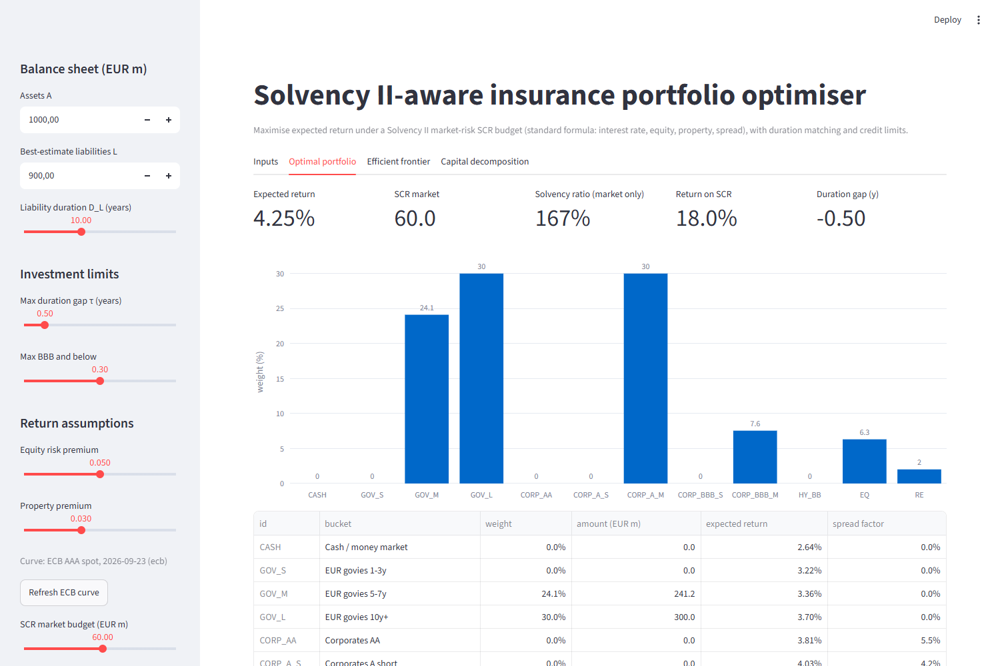
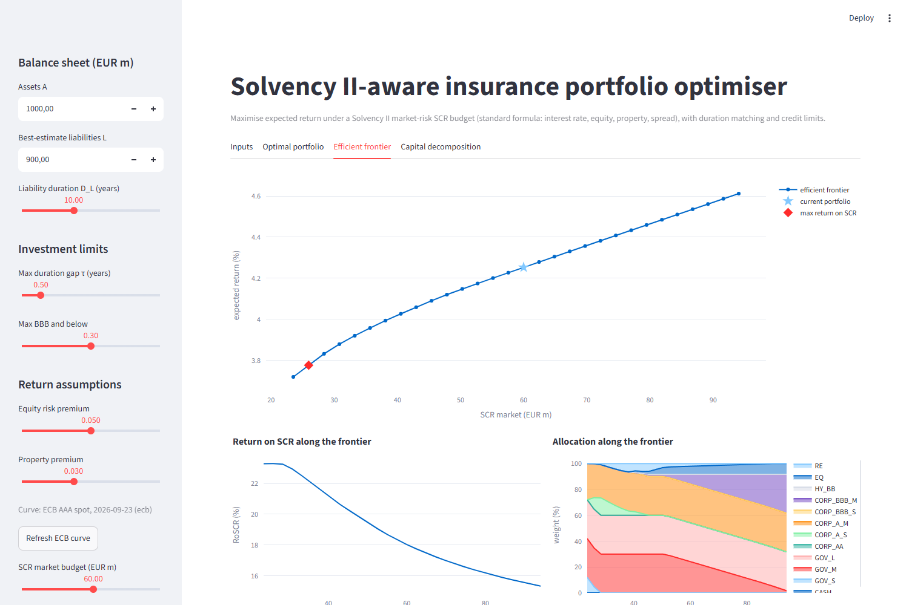
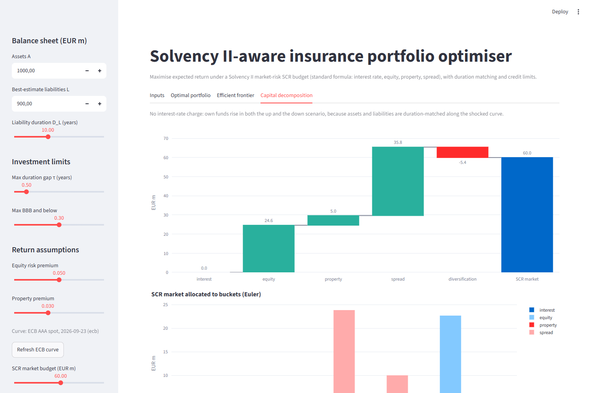

# Insurance portfolio optimiser under Solvency II

An insurer holds assets against long-dated liabilities, and under Solvency II every asset it
holds consumes regulatory capital. The investment question is: **which allocation earns the most
return per euro of capital consumed, while staying duration-matched to the liabilities and within
risk limits?**

This tool answers it for a stylised balance sheet (EUR 1,000m of assets, EUR 900m of
best-estimate liabilities). It computes the **Solvency II standard-formula market-risk SCR**
(interest rate, equity, property and spread sub-modules), **maximises expected return under an
SCR budget** as a convex second-order cone program, draws the **return / SCR efficient frontier**,
and shows **where the capital goes**.



## Features

- **SCR engine** (`src/iro/scr.py`): interest rate (up and down scenarios on the ECB AAA curve),
  equity type 1, property and spread on bonds, aggregated with the regulatory correlation matrix;
  diversification benefit; Euler allocation of the SCR to buckets and sub-modules.
- **Optimiser** (`src/iro/optimizer.py`): return maximisation under an SCR budget with
  concentration caps, a BBB-and-below limit and a dollar-duration gap constraint (cvxpy, Clarabel);
  minimum-SCR and unconstrained portfolios.
- **Efficient frontier and return on capital** (`src/iro/frontier.py`).
- **Data layer** (`src/iro/db.py`, `src/iro/data_ecb.py`): SQLite database holding the
  universe, assumptions, yield curves and optimisation runs; live ECB AAA spot curve, cached,
  with an offline fallback.
- **Streamlit app** (`app.py`): editable assumptions, optimal portfolio, frontier, capital
  decomposition.
- **68 tests** (pytest), including hand-computed regulatory values and app smoke tests.

## Quick start

```powershell
git clone https://github.com/Iceade-1/insurance-portfolio-optimizer.git
cd insurance-portfolio-optimizer
python -m venv .venv
.venv\Scripts\Activate.ps1          # macOS / Linux: source .venv/bin/activate
pip install -r requirements.txt
pytest
streamlit run app.py
```

Set `IRO_OFFLINE=1` to run without network access (cached or built-in curve).

## Model

### Balance sheet and universe

Assets `A`, best-estimate liabilities `L` with modified duration `D_L`, and 12 buckets: cash,
EUR govies (short / medium / long), corporates by rating (AA, A, BBB) and duration, BB high
yield, equity and property. Durations, spreads, expected losses and caps are assumptions,
editable in the app.

### Expected returns

Carry on the AAA curve `r(·)`: govies and cash earn `r(D)`, corporates `r(D) + spread − PD·LGD`,
equity `r(10) + ERP` and property `r(10) + premium`.

### SCR market (Delegated Regulation (EU) 2015/35)

For weights `w` (summing to 1), every sub-module charge is **linear in `w`**:

| Sub-module | Charge | Article |
|---|---|---|
| Spread | `Σ A·wᵢ·stressᵢ(durᵢ, CQSᵢ)`, 0 for EEA govies | 176, 180(2) |
| Equity | `39 % · A · w_EQ` | 169 |
| Property | `25 % · A · w_RE` | 174 |
| Interest (up / down) | `Σ A·wᵢ·Dᵢ·Δyᵢ − L·D_L·Δy_L`, floored at 0 | 165–167 |

Rate moves apply the relative shocks of Art. 166–167 to the AAA spot curve, with a first-order
duration approximation. The sub-modules are aggregated as `SCR = sqrt(sᵀ C s)`, where the
interest charge is the larger of the two scenarios and sets the correlation parameter `A`
(0 in the up scenario, 0.5 otherwise, Art. 164).

### Optimisation

```
maximise    μᵀw
subject to  Σw = 1,   0 ≤ w ≤ cap
            Σ_{BBB and below} w ≤ limit
            |A·Σ wᵢDᵢ − L·D_L| / A ≤ τ                          (dollar-duration gap)
            t_s ≥ loss_s(w),  t_s ≥ 0                            s ∈ {up, down}
            ‖ chol(C_s)ᵀ · [t_s, eq(w), prop(w), spread(w)] ‖₂ ≤ B   s ∈ {up, down}
```

**Why it is convex.** Every charge is affine and non-negative in `w` (the interest charge through
the auxiliary variable `t_s`), and every correlation is non-negative. So `sqrt(sᵀCs)` is a norm
that is non-decreasing in each component, and each budget constraint is a second-order cone.

**A conservative choice.** The regulation aggregates only in the scenario that gives the larger
interest charge. Requiring the budget in *both* scenarios keeps the problem convex and is
conservative: the true SCR of any feasible portfolio is within the budget. The tests recompute
the regulatory SCR outside cvxpy to check this.

### Return on capital

`RoSCR = (μᵀw·A − r(D_L)·L) / SCR`: the return earned above the cost of the liabilities, per
euro of capital. Along the frontier it falls as the budget grows (from about 23 % to 15 % with
the default inputs), because each extra euro of capital buys less return.

## Screenshots

| Efficient frontier | Capital decomposition |
|---|---|
|  |  |

## Regulatory parameters: what was checked

All parameters were checked against the text of **Commission Delegated Regulation (EU) 2015/35
as adopted** (OJ L 12, 17.1.2015), using the Official Journal PDF:

| Parameter | Article | Status |
|---|---|---|
| Spread risk factors by CQS and duration band, `min[...; 1]` cap above 20y | 176(3) | ✅ checked (AA row: 8.4 %, 10.9 %, 13.4 %) |
| Duration floored at 1 year for spread risk | 176(2) | ✅ checked |
| 0 % spread charge on EEA central governments in domestic currency | 180(2) | ✅ checked |
| Relative rate shocks 1–20y and 90y, linear interpolation, flat outside | 166(1), 167(1) | ✅ checked (full tables) |
| Rate increase of at least 1 percentage point | 166(2) | ✅ checked |
| No decrease for negative rates | 167(2) | ✅ checked |
| Interest charge = larger of the up / down scenarios | 165(1) | ✅ checked |
| Market correlation matrix, A = 0 (up scenario) or 0.5 (otherwise) | 164(3) | ✅ checked |
| Equity type 1: 39 % (symmetric adjustment not modelled) | 169(1)(b) | ✅ checked |
| Property: 25 % | 174 | ✅ checked |

## Simplifications and limits

- **2015 standard formula.** Later amendments (Delegated Regulation (EU) 2019/981 and the
  Solvency II review, including the new interest-rate method) are not reflected.
- **Market risk only.** No currency or concentration sub-module, no counterparty, life or
  non-life risk, so the "solvency ratio" shown is market-risk only.
- **No equity symmetric adjustment**; equity is treated as type 1.
- **Duration approximation** for rate moves, and a single duration for the liabilities
  (no cash-flow ladder, no convexity).
- **No loss-absorbing capacity** of technical provisions or deferred taxes.
- **Illustrative assumptions** for spreads, expected losses and premia.

## Next steps

- Liability cash-flow ladder and full revaluation instead of durations
- The Solvency II review interest-rate method (shift + relative shocks, negative rates)
- ESG exclusions and constraints per bucket
- Ex-post risk monitoring: historical VaR / Expected Shortfall of the optimal portfolio

## Project layout

```
src/iro/
  schema.sql     SQLite schema
  db.py          universe, assumptions, runs
  data_ecb.py    ECB AAA curve: fetch, cache, fallback, interpolation
  returns.py     expected returns
  scr.py         SCR market engine
  optimizer.py   SOCP optimiser
  frontier.py    efficient frontier, return on SCR
app.py           Streamlit front end
tests/           pytest suite
```
